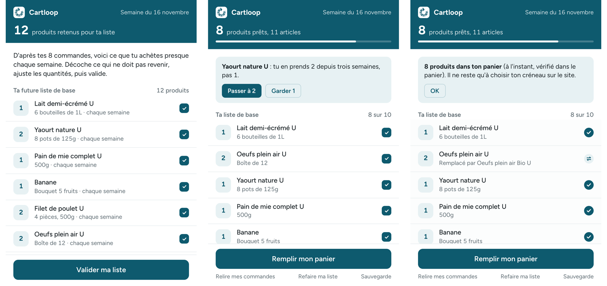

<p align="center"></p>

# Cartloop

**Tes courses Courses U de la semaine en un clic.** Cartloop est une petite extension
de navigateur qui apprend ce que tu achètes en drive sur coursesu.com, et à quel
rythme. Elle remplit ton panier de la semaine en un clic, et te rappelle ce qui va
bientôt manquer.

Elle ne passe jamais la commande à ta place : le créneau et la validation restent sur
le site.

> Outil personnel, gratuit, indépendant. Non affilié à Courses U ni à Système U.

<p align="center"></p>

## Ce qu'elle fait

- **Elle se souvient de tout.** Le site n'affiche que tes 8 dernières commandes.
  Cartloop les recopie dans ton navigateur, semaine après semaine.
- **Elle te propose ta liste.** Au premier lancement, elle repère ce que tu achètes
  presque chaque semaine. Tu coches, tu ajustes les quantités, tu valides.
- **Elle remplit le panier, puis vérifie.** Un clic ajoute ta liste au panier. Ensuite
  Cartloop relit le vrai panier et te dit ce qui y est vraiment. Si un produit manque,
  elle essaie ses remplaçants ; sinon elle te dit lequel remplacer à la main.
- **Elle te rappelle le reste.** Papier toilette, lessive, dentifrice : chaque produit
  a son rythme, appris sur tes achats. Le moment venu, il apparaît dans « Pense aussi à ».
- **Elle propose, tu décides.** « Tu n'as plus pris de poêlée depuis 3 semaines, je la
  retire ? » Rien ne change sans ton accord. Tu peux aussi modifier ta liste toi-même :
  ajouter n'importe quel produit déjà acheté sur ton compte (avec un filtre pour le
  retrouver), retirer un produit, écarter un rappel, ou refaire ta liste.

## Installer (Brave, Chrome, Edge)

Cartloop n'est pas sur le Chrome Web Store. On l'installe à la main, en deux minutes.

1. Télécharge ce dépôt : bouton vert « Code », puis « Download ZIP ». Décompresse-le
   dans un dossier où il restera, par exemple `Documents/Cartloop`.
   **Ne déplace plus ce dossier ensuite** : le navigateur y relit l'extension.
2. Ouvre `brave://extensions` (ou `chrome://extensions`, ou `edge://extensions`).
3. Active le « Mode développeur », en haut à droite.
4. Clique sur « Charger l'extension non empaquetée » et choisis le dossier `extension`.
5. Épingle l'icône : pièce de puzzle dans la barre du navigateur, puis la punaise à
   côté de Cartloop.
6. Va sur coursesu.com, connecte-toi, et clique sur l'icône.

Le navigateur peut afficher un rappel sur les extensions en mode développeur : c'est
normal pour une extension installée à la main.

### Mettre à jour

1. Dans Cartloop, « Sauvegarde », puis « Télécharger la sauvegarde ». Par précaution.
2. Remplace le contenu du dossier par celui de la nouvelle version, **au même endroit**.
3. Sur la page des extensions, clique sur la flèche « Recharger » de Cartloop.

Ne clique jamais sur « Supprimer » : ça efface l'historique que le site ne garde plus.
Si c'est arrivé, « Restaurer une sauvegarde » le remet.

## Ce que l'extension voit et fait

Une extension inconnue mérite qu'on vérifie. Voici tout. Le code tient en environ
1 200 lignes de JavaScript lisible, sans aucune dépendance ni étape de construction.

- **Une seule autorisation** (`storage`, pour garder tes données) et **un seul site**,
  `www.coursesu.com`. Aucun autre site, aucun accès à ton historique de navigation.
- **Aucun serveur, aucun compte, aucune statistique.** Tout reste dans ton navigateur.
  Aucun code n'est chargé depuis Internet : même la police est embarquée.
- **Ce qu'elle lit** : la page « Mes commandes » et le détail de chaque commande, dans
  ta session ouverte. Environ 9 pages la première fois, puis en général 1 à 3 pages
  toutes les 6 heures au plus, quand tu es sur le site. Rien d'autre, même sur les pages de
  connexion ou de paiement où son script est chargé.
- **Ce qu'elle fait** : quand tu cliques sur « Remplir mon panier », elle envoie un
  ajout par produit coché, l'un après l'autre (jamais en même temps), avec une courte
  pause entre deux, puis relit ton panier une ou deux fois. Compter une dizaine de
  secondes pour 13 produits. Elle s'arrête net si le site refuse.
  Elle ne touche jamais au paiement ni à la validation de la commande.
- **Ta sauvegarde** est un fichier qui contient la liste de tes achats : garde-le pour toi.
- **Tout effacer** : supprime l'extension depuis la page des extensions.

C'est un outil non officiel, testé sur un seul compte et un seul magasin. Le site peut
changer du jour au lendemain : Cartloop le signale alors au lieu d'enregistrer des
données fausses. Tu l'utilises sous ta responsabilité.

## Comment ça marche

- **Une commande = une semaine.** Le temps se compte en commandes, pas en jours : une
  semaine de vacances ne fausse aucun rythme. Deux commandes la même semaine comptent
  pour deux semaines (pour l'instant).
- **Chaque produit a son rythme**, celui de ses trois derniers rachats. Une habitude
  abandonnée n'est plus rappelée.
- **L'hygiène et l'entretien se regroupent par besoin** : deux marques de liquide
  vaisselle, c'est le même besoin (`extension/familles.json`). L'alimentaire, lui,
  est suivi produit par produit.
- **Les propositions attendent trois commandes de preuve** après ta dernière décision
  sur le produit.

Tout le calcul tient dans `extension/rythme.js`, testé :

```bash
node --test outils/
```

## Licence

MIT, voir [LICENSE](LICENSE). Police Figtree sous licence SIL Open Font
(`extension/polices`).
